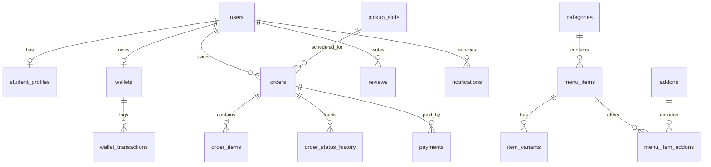

# 🗄️ Smart Cafeteria - Database Documentation & Schema Guide

This database implementation is built directly from the uploaded **`cafeteria_schema.sql`**. It provides complete data persistence for the Smart Cafeteria Pre-Order platform with full support for both **SQLite** (`cafeteria.db`) and **PostgreSQL**.

---

## 📁 Database Files

| File | Purpose |
|---|---|
| [**`schema_postgres.sql`**](file:///d:/new/schema_postgres.sql) | Native PostgreSQL schema with ENUMs, `pgcrypto` UUIDs, sequences, indexes, and views. |
| [**`schema_sqlite.sql`**](file:///d:/new/schema_sqlite.sql) | Transpiled SQLite schema with 100% constraint and table parity for Python standard library `sqlite3`. |
| [**`init_database.py`**](file:///d:/new/init_database.py) | Python script that executes the schema and seeds complete cafeteria records. |
| [**`init_db.bat`**](file:///d:/new/init_db.bat) | Windows batch script to build and seed the database with one click. |
| [**`database.py`**](file:///d:/new/database.py) | Python database connection manager. |
| [**`models.py`**](file:///d:/new/models.py) | Python data access models for Users, Menu, Orders, and Wallet. |

---

## 🏗️ Schema Overview (28 Tables + 3 Views)



### 1. Auth & User Accounts
* **`users`**: Base user table with `id` (UUID), `role` (`student`, `staff`, `admin`), `full_name`, `email`, `phone`, `password_hash`, `avatar_url`, and `is_active`.
* **`student_profiles`**: Linked to `users(id)` with `roll_number` (`STU-2024-8842`), `department` (`CSE - 2nd Year`), `year_of_study`, `dietary_preference` (`veg`), `allergies`, and notification preferences.
* **`otp_codes`**: Manages verification codes for password reset and phone/email validation.
* **`refresh_tokens`**: Stores hashed JWT refresh tokens with revocation support.

### 2. Menu, Variants & Add-ons
* **`categories`**: Menu categories (*Breakfast*, *Lunch*, *Snacks*, *Beverages*, *Desserts*).
* **`menu_items`**: Complete dish information including `name`, `category_id`, `base_price`, `diet` (`veg`, `non_veg`, `vegan`, `egg`), `calories`, `prep_time_mins`, `is_available`, `is_special` (today's special), `stock_qty`, and `avg_rating`.
* **`item_variants`**: Size variations (*Regular*, *Large*, *Meal Combo*) with price deltas.
* **`addons`**: Extra add-ons (*Extra Cheddar Cheese*, *Double Veg Patty*, *Peri-Peri Seasoning*, *Desi Ghee Roast*).
* **`menu_item_addons`**: Many-to-many junction table mapping dishes to allowed add-ons.
* **`favorites`**: User saved favorite dishes.
* **`stock_movements`**: Real-time kitchen inventory tracking (`restock`, `sale`, `wastage`, `adjustment`).

### 3. Cafeteria Settings & Slots
* **`cafeteria_settings`**: Global single-row configuration (operating name, address, `tax_percent` = 5.00%, `is_open`, `slot_length_mins` = 15, `default_slot_cap` = 20).
* **`operating_hours`**: Weekly operating times (opens at 07:30, closes at 22:00, Monday to Sunday).
* **`pickup_slots`**: Counter collection slots for today with date, start/end times, capacity, and `booked_count`.

### 4. Cart & Coupons
* **`carts`**: Active user carts with coupon associations.
* **`cart_items`**: Individual dishes in the cart with quantities, selected variants, and cooking instructions.
* **`coupons`**: Discount promotions (`CAMPUS10`, `STUDENT50`, `WELCOME20`) with flat/percent rules, minimum order values, and expiration dates.
* **`coupon_usages`**: Tracks user redemption history to enforce `per_user_limit`.

### 5. Orders, Lifecycle & Verification
* **`orders`**: Primary order table featuring:
  * `order_number`: Formatted order ID (e.g. `ORD-10045`).
  * `pickup_slot_id`: Scheduled counter collection slot.
  * `status`: `placed` → `accepted` → `preparing` → `ready` → `collected`.
  * `subtotal`, `discount_amount`, `tax_amount` (5% GST), `total_amount`.
  * `pickup_qr_token`: Unique cryptographic hex token for counter scanning.
  * `invoice_number`: Tax invoice code (e.g. `INV-2026-10045`).
* **`order_items`**: Immutable order snapshot capturing item name, unit price, quantity, and line total.
* **`order_status_history`**: Audit trail powering the live progress timeline with stage change timestamps.

### 6. Payments & Campus Wallet
* **`payments`**: Payment records (`upi`, `card`, `net_banking`, `wallet`, `pay_at_counter`) with gateway transaction IDs.
* **`saved_payment_methods`**: Saved payment tokens for 1-click checkout.
* **`wallets`**: Student digital dining wallet with balance (₹480.00) and loyalty reward points.
* **`wallet_transactions`**: Itemized transaction ledger (`topup`, `payment`, `cashback`, `refund`).

### 7. Reviews, Notifications & Audit
* **`reviews`**: Verified customer reviews with 1–5 star food/service ratings and comments.
* **`notifications`**: Order ready updates and wallet cashback alerts.
* **`audit_logs`**: Administrative audit trail for menu price changes and staff activities.

### 8. Database Views
* **`v_daily_sales`**: Aggregates daily orders count and revenue for successful orders.
* **`v_top_items`**: Ranks most popular cafeteria dishes by units sold and revenue.
* **`v_low_stock`**: Real-time kitchen alert view for dishes where `stock_qty <= low_stock_alert`.

---

## 🚀 How to Build the Database

### Option 1: Native Windows Executable (No Python Required)
You can directly run the pre-compiled Windows native database builder:
```cmd
build_database.exe
```
Or double-click [**`init_db.bat`**](file:///d:/new/init_db.bat). It uses Windows built-in `winsqlite3.dll` to execute [**`schema_sqlite.sql`**](file:///d:/new/schema_sqlite.sql) and [**`seed_data.sql`**](file:///d:/new/seed_data.sql), immediately generating [**`cafeteria.db`**](file:///d:/new/cafeteria.db).

### Option 2: Python Script
If Python is installed on your machine:
```bash
python init_database.py
```

### Option 3: PostgreSQL Server
If using an external PostgreSQL instance:
```bash
psql -U postgres -d cafeteria_db -f schema_postgres.sql
```

---

## 📊 Pre-Populated Sample Data Summary
- **Primary User**: Kumud Negi (`kumud.negi@college.edu`), Roll No: `STU-2024-8842`, CSE 2nd Year
- **Staff / Counter 1**: Chef Ramesh Kumar (`ramesh.counter1@college.edu`)
- **Admin**: Cafeteria Manager Sharma (`cafeteria.admin@college.edu`)
- **Menu Catalog**: 12 dishes across Breakfast, Lunch, Snacks, Beverages, and Desserts with real prices and calorie counts
- **Active Mockup Order**: `ORD-10045` (Veg Burger, Cold Coffee, French Fries — Total ₹204.75, Token `a8f93c04d1e2b588`, Status: `preparing`)
- **Past Order**: `ORD-10032` (Masala Dosa, Cold Coffee — Total ₹136.50, Status: `collected`)
- **Digital Wallet**: ₹480.00 current balance, 1,240 reward points
- **Active Pickup Slots**: 11:30 AM to 01:15 PM in 15-minute intervals
- **Promotional Coupons**: `CAMPUS10` (₹10 off), `STUDENT50` (₹50 off), `WELCOME20` (20% off)
```
This builds and seeds **`cafeteria.db`** with all 28 tables and sample data.

### For PostgreSQL
Create a PostgreSQL database and apply the schema:
```bash
createdb cafeteria
psql -d cafeteria -f schema_postgres.sql
```
